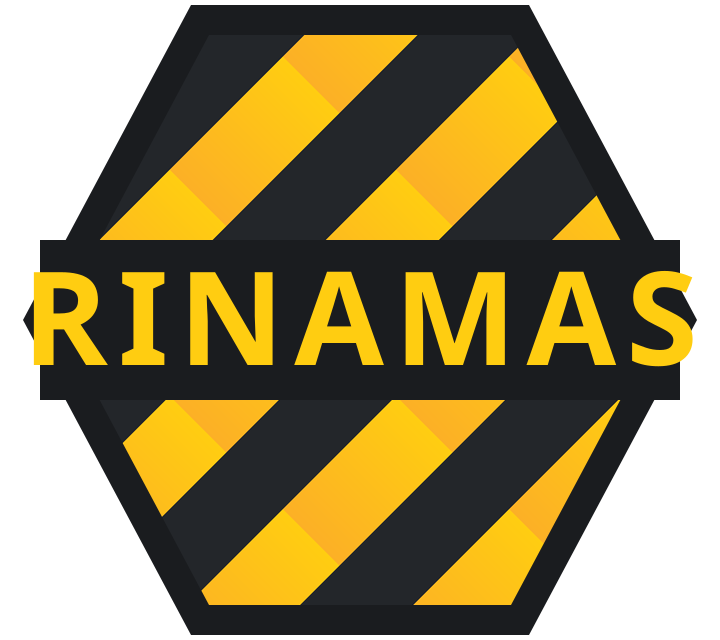
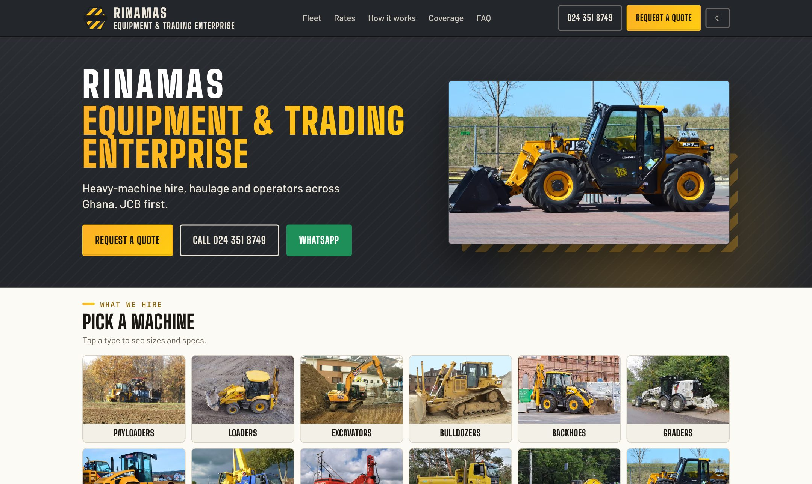
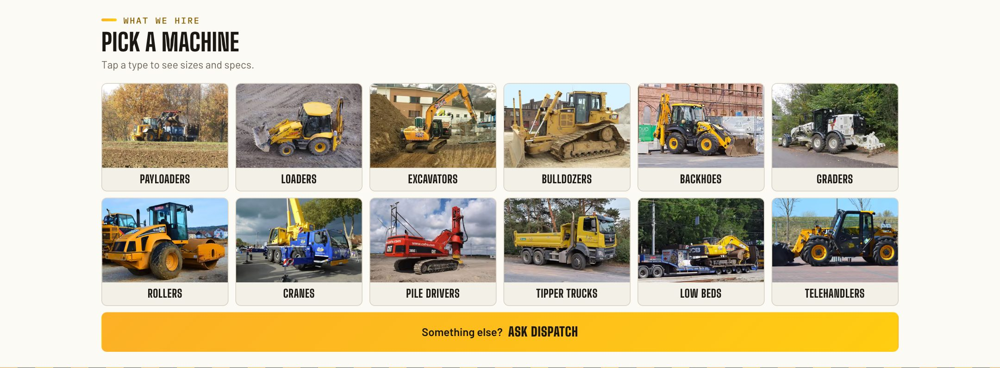
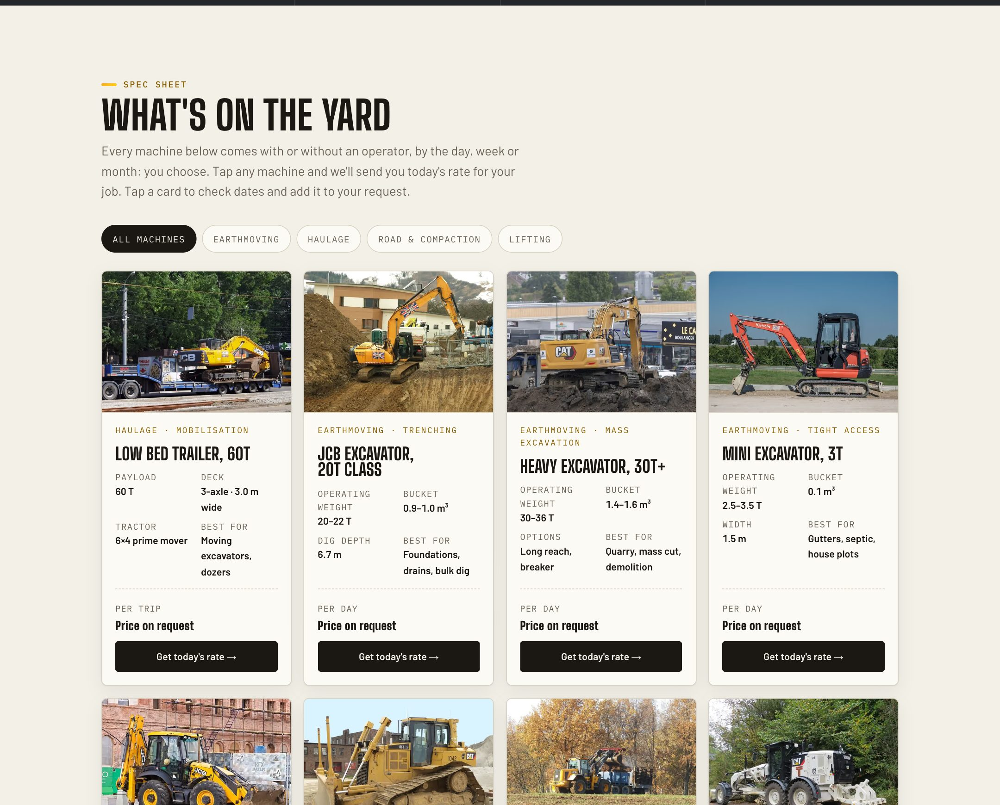
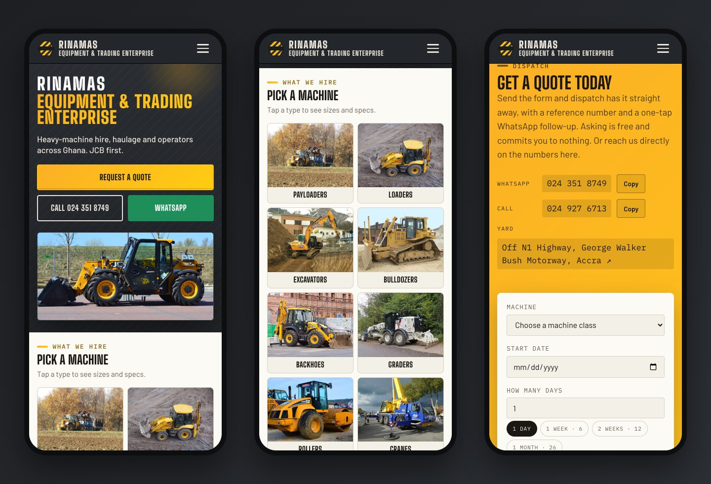
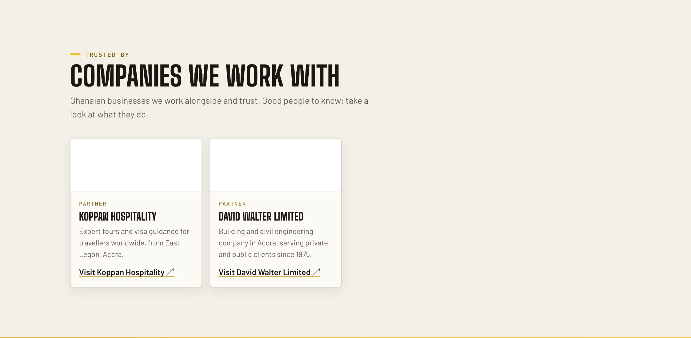

<div align="center">



# RINAMAS Equipment &amp; Trading Enterprise

**Heavy-machine hire, haulage and operators across Ghana. JCB first.**

[**rinamas.com**](https://rinamas.com) &nbsp;·&nbsp; [WhatsApp 024 351 8749](https://wa.me/233243518749) &nbsp;·&nbsp; [Request a quote](https://rinamas.com/#quote)

<br>



</div>

## What we hire



Excavators from 3 T to 30 T+, payloaders and wheel loaders, bulldozers, backhoes, motor graders, rollers, mobile cranes, piling rigs, telehandlers, tipper trucks and a 60 T low bed. With or without an operator, by the day, week or month, delivered from our yard off the N1 in Accra to sites across Ghana.



## Built for the phone in your pocket



Pick a machine, choose your dates and site, and send a request in under a minute. You get a reference number, a page that tracks your hire, and a one-tap WhatsApp line to dispatch.

## Companies we work with



<br>

<details>
<summary><b>Under the hood</b> (for developers)</summary>

<br>

The public site and the dispatch desk are one Next.js app.

| | |
|---|---|
| **Customers** | Fleet spec sheet, rate card or "today's rate" mode, live estimate on the quote form, a tracking page per request |
| **Dispatch desk** (`/admin`) | One hire record per job: quote, deposit, dispatch and return with meter readings, daily hour log, payments, final bill worked out from the log |
| **Management** | Finance (collected, billed, owed, CSV export), pricing rules and transport zones, staff accounts, full activity log, AI fill from a machine photo |
| **Stack** | Next.js 15, React 19, Prisma 6 on Postgres, Zod, Vercel (Blob for photos, AI Gateway) |

```bash
cp .env.example .env    # set the passwords and SESSION_SECRET
npm install
createdb rinamas        # local Postgres
npm run db:push && npm run db:seed
npm run dev             # http://localhost:3000, desk at /admin
npm test                # pricing and settlement tests
```

</details>

<br>

<sub>Machine photos are from Wikimedia Commons contributors under CC BY and CC BY-SA licences, credited on <a href="https://rinamas.com">rinamas.com</a>, until our own photography replaces them. Partner logos belong to their owners. © RINAMAS Equipment &amp; Trading Enterprise. All rights reserved.</sub>
